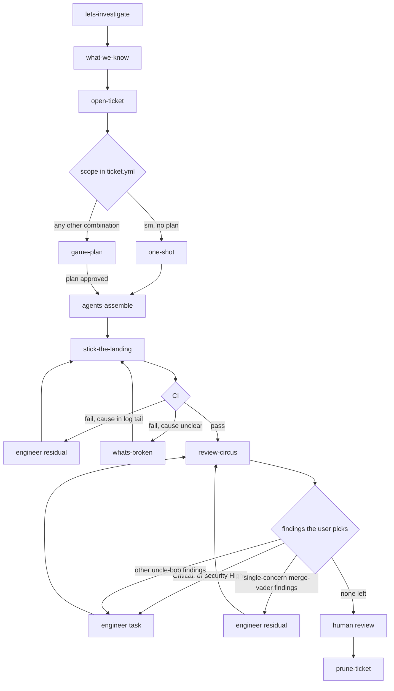
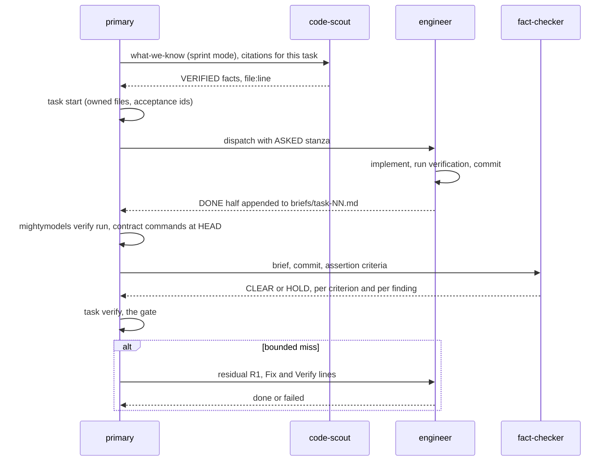
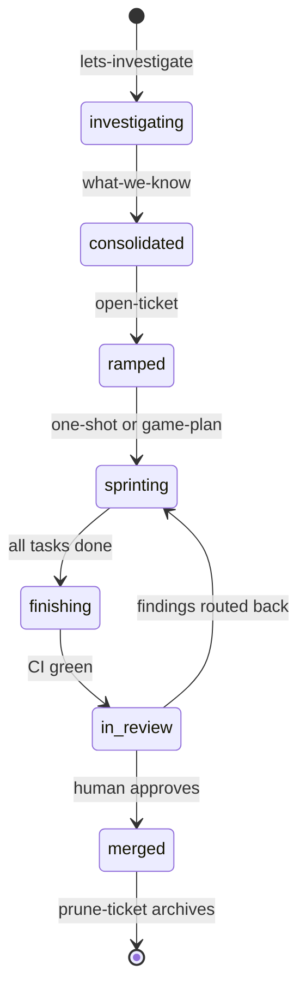

# The workflow

mightymodels splits one unit of work across several short sessions, each with a narrow job and a
written artifact. The primary agent in every session delegates aggressively: scouts do the
reading, implementers do the writing, and the primary spends its context on routing and
judgment. State lives in `.mightymodels/<slug>/` and in the plugin's state database, not in
anyone's conversation history, so a session can die or compact without losing the ticket.

The diagram below is the whole loop, including the two repair cycles that make it honest: CI
failures route back to a fixer, and review findings route back as tasks of their own.

## Investigate

Work starts in chat, before any ticket exists. `lets-investigate` runs a gated investigation:
the primary states the target plainly, dispatches code-scout and web-scout one narrow question
at a time, and folds every report into a ledger that is restated in chat and saved in the state
database. Scouts retrieve; they do not diagnose. Each round stops at a gate where the user
chooses to dig further, redirect, stop, or consolidate through `what-we-know`.

`what-we-know` consolidates: a table of knowns with file:line citations, an enumerated list of
uncertainties, each uncertainty resolved through the ask-user dialog, and an analysis shaped by
the question. This is the moment the human steers. The same skill also runs in a stripped-down
sprint mode later, where it gathers citations for a single task and asks nothing.

## Hand off

`open-ticket` turns understanding into a startable unit of work. Its interview asks what to call
the ticket and which tracker it gets (GitHub, Jira, both or none); the `ticket` tool then asks
for the scope, the branch, and whether a compaction is likely. From the answers it creates
`.mightymodels/<slug>/` with `ticket.yml` (scope, routing, companion docs), optionally files
the issue with a checked body, cuts and pushes the branch, and validates the ticket into the
state database. An expected compaction sets `plan-first: true`. The models in `ticket.yml` are
the fleet's fixed ones, so the scope sizes the ticket and moves no worker to another model. It
ends by asking whether to plan now, go straight to `one-shot`, or hand off through `baton-pass`,
which writes `handoffs/BATON.md` and prints the next session's opening prompt.

## Ramp

The next session starts fresh and cheap. Which ramp it takes is not a judgment call; it is read
from `ticket.yml`. This table is the canonical statement of the routing rule; every other
document points here rather than restating it:

| scope | plan-first | ramp |
| ----- | ---------- | ----------- |
| sm | false | `one-shot` |
| sm | true | `game-plan` |
| med | false | `game-plan` |
| med | true | `game-plan` |
| large | false | `game-plan` |
| large | true | `game-plan` |

`one-shot`: one short interview for whatever the context has not answered (it also runs without
a ticket, staging one itself), reconfirm the claims at HEAD with two or three scouts, write the
task list with an acceptance criterion per item into the issue body, get its commands approved
into the verification contract, and hand straight to `agents-assemble`; it assumes no
compaction. An explicit `/one-shot` runs on any scope after an ask-user confirmation on med or
large. `game-plan`: verify claims with scouts while `terry-toolchain` surveys the environment
into `toolchain.md`, run `cross-examine`, then write `plan.md` as high-level strategy with
enumerated tasks and a size on each (`tiny`, `sm`, `med` or `large`), deliberately free of code
citations because citations go stale while the plan survives compaction. It also asks who
answers a blocked task, which is where `auto-escalate` in `ticket.yml` comes from. The user
approves the plan before any dispatch.

## Sprint

`agents-assemble` runs the per-task loop. One iteration looks like this:

The ASKED half is written by the primary at dispatch: objective, checkable acceptance criteria,
verification commands, the files the task owns, and the engineer tier from `ticket.yml`. The
implementer appends the DONE half when it finishes. The whole brief is capped at 80 lines,
roughly 15 ASKED and up to 65 DONE, and the fact-checker checks the halves against each other
rather than trusting either. The primary runs the contract commands itself, and the `task`
tool's `verify` closes the task only when the commit is HEAD, those commands passed at it, the
brief names that commit, every other criterion carries a citation, and the commit stayed inside
the owned files.

A task's size picks its worker. A `tiny` task, one owned file and every criterion a command,
goes to the intern for one attempt; every other size goes to the engineer. `start` refuses a
task with more than four acceptance criteria or more than ten owned files and names
`break-it-down`, which splits the task and waits for the user's answer.

What does not verify is routed, never retried blind. A bounded miss becomes an engineer residual
under an `R<n>` task with one attempt, and a task the gate left blocked is started again and
verified at its residual's commit. A blocked intern task goes to the engineer. A failed or
blocked engineer task goes to the user first, then to the architect for one pass; with
`auto-escalate: true` in `ticket.yml` it goes to the architect without the question. When the
architect fails too, `whats-broken` takes over, a phased debugging protocol with a three-strike
breaker that escalates to the human instead of attempting a fourth patch.

While the ticket is open, hooks hold the primary to this loop. An `Edit` or `Write` from the
main conversation outside the ticket directory is answered `ask`, a dispatch of the engineer or
the architect is denied until a task is started, and a `git push` is denied until the sprint is
ready to land. [docs/claude-code.md](claude-code.md) has the full list.

The loop advances only after its evidence is externalized: the implementer appends the DONE half
(with the commit hash) to the brief before reporting, the verification outcome is recorded
before the next task starts, and recovery reads the `task` tool and the brief, never anyone's
conversation. The full ordering rule lives in
`plugins/mightymodels/skills/agents-assemble/references/contracts.md`.

The sprint ends with a `REPORT.md` of at most 50 lines: what shipped, what deviated, what
remains.

## Finish

`stick-the-landing` runs only when the user starts it. It checks the `task` tool's `ready`
action, pushes the branch, opens the PR from the repo's template, and dispatches `gitty-up` to
watch CI. Each failing check becomes a `C<n>` task routed by the log-tail test: if the fix is
obvious from the last screen of the log, it is an engineer residual; if the cause needs actual
investigation, it is `whats-broken`. Every fix moves HEAD, so the whole contract is run again
before the next push. On green, the skill asks whether to review now or hand off to a review
session through `baton-pass`.

## Review

`review-circus` is the endgame session. One gate sets the depth, the emphasis and the scope;
the plugin's `review-metrics` and `review-signals` commands measure the surface, then
`uncle-bob` and `merge-vader` run in parallel on the models the depth sets, writing reports
into the run's directory under `.mightymodels/<slug>/review/`. Overlapping findings are merged
and severity-unified through the shared table in `contracts.md`, and an abridged,
human-readable comment is always posted to the PR, pass or fail, so the review trail is
documented where reviewers live.

The user decides each finding by id, and nothing the user did not pick is fixed. Remediation
routes by risk first, then by source. A Critical finding, or a security finding at High severity
or above, goes to a full engineer task no matter which reviewer surfaced it: a severity that
says "harm now" outranks any statement about who found the defect. Below that line, source
decides: uncle-bob findings concern structure and abstraction, so they go to a full engineer
task; a single-concern merge-vader finding with usable Fix and Verify lines goes to an engineer
residual. Each fix runs under its own `R<n>` task with its Verify command in the contract, and a
fix that fails climbs to the architect the way a sprint task does.

## Prune

After human review and merge, `/prune-ticket` closes the ticket: it compresses the directory
into an archive of at most 30 lines (what shipped, PR link, decisions, gotchas), proposes any
cascading documentation updates as diffs for approval, and deletes the ticket directory. It
refuses while live work remains, such as an active `whats-broken.md` or unpushed commits.

## Ticket lifecycle

## Where the rules live

Prose in this directory explains; the contracts define. The severity table, verdict vocabularies
(code-scout, web-scout, fact-checker, engineer, architect, the `task` tool, gitty-up, review),
and the two-half brief schema are in
`plugins/mightymodels/skills/agents-assemble/references/contracts.md`. The `ticket.yml` schema
with its derivation rules is in
`plugins/mightymodels/skills/open-ticket/references/ticket-schema.md`, and the directory
layout with its writer/reader matrix is in
`plugins/mightymodels/skills/open-ticket/references/mightymodels-dir.md`. When this page
and a contract disagree, the contract wins.
