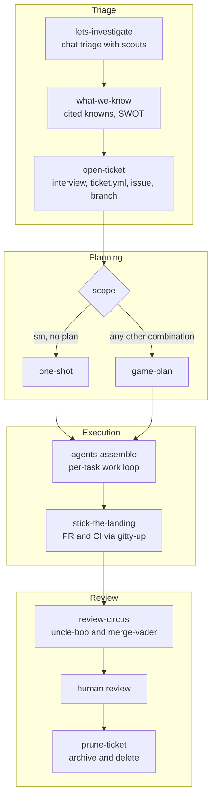

# mightymodels

mightymodels takes a piece of work from the first question to a merged PR. Cheap workers do the reading, you make the decisions, and nothing is called done until a command proves it.

Each piece of work gets one `.mightymodels/<slug>/` directory and one `ticket.yml` carrying its scope and model routing. When the work merges, `/prune-ticket` compresses the directory into a 30-line archive and deletes it. The unit of deletion is the unit of work, which is what stops working state from turning into a landfill of stale evidence.

The plugin ships nineteen skills, twelve worker agents, seven hooks and one MCP server that holds the state.

## Why I built it

mightymodels is built from the failures of spec-driven development. It is oriented around human-in-the-loop decision making, and it is the plugin I cannot live without. It has cut my token consumption, the model gets more of the work right, and it has changed the way I work with AI.

I have no numbers for any of that yet. I plan to evaluate this release aggressively over the coming days, and what I measure will go here.

### The problems it goes after

Each row is a way agent work goes wrong, and what the loop does about it.

| What goes wrong | What mightymodels does |
| --- | --- |
| A plan written up front goes stale as the code moves. | `plan.md` is a ledger of invariants, tasks, non-goals and risks, deliberately free of code citations. Citations are gathered fresh for each task, at the moment it starts. |
| The agent makes a decision that was yours to make. | Facts go to scouts and decisions go to you. Investigation rounds stop at a gate, the plan needs your approval before any dispatch, and no review finding is fixed unless you picked it. |
| "Done" is a claim nobody checked. | The primary writes what was asked, the implementer writes what it did, and the fact-checker compares the two. A task closes only when its contract commands passed at HEAD. |
| An expensive model spends its context reading files. | Scouts do the reading on `haiku`. The primary spends its context on routing and judgment. Each worker refuses the work of the tier above it. |
| The state lives in a conversation and dies with it. | State lives in the ticket directory and the state database. A session can die or compact without losing the ticket. |
| A failure gets retried blind. | What does not verify is routed: to a residual fix, then to you, then to the architect, then to a debugging protocol that stops after three strikes. |
| Working files pile up long after the work merged. | `/prune-ticket` archives the ticket in 30 lines and deletes the directory. |

## Requirements

- Claude Code.
- [uv](https://docs.astral.sh/uv/) on `PATH`. The launcher, the hooks and the state server all start through `uv tool run`.
- Python 3.14 or newer. uv fetches it, so nothing needs installing by hand.
- A POSIX system. Everything in `bin/` is an `sh` or `bash` script and there is no Windows launcher.
- `git`. A ticket's files live in `.mightymodels/` at the git toplevel of the repository you are working in, and the hooks look up the ticket for the checked-out branch.
- The [GitHub CLI](https://cli.github.com/) (`gh`), logged in, for issues, pull requests and CI watching. Without it `open-ticket` keeps the issue body as a file and shows you the command, and `stick-the-landing` shows the `gh pr create` command and stops.
- The `jira` CLI, only if you pick Jira as a ticket's tracker. Without it `open-ticket` writes a draft file.
- Network access to a package index the first time uv builds the environment.

## Install

```text
/plugin marketplace add <owner>/rygentic-harness
/plugin install mightymodels@rygentic-harness
```

Run `/agents` in a session afterwards. The twelve workers should be listed as `mightymodels:<folder>:<name>`. If they are not, fix the install before debugging the loop, because the ticket routing dispatches workers by those types.

Plugin skills show up as `/mightymodels:agents-assemble`, and the short form `/agents-assemble` works whenever the name is unambiguous in your session.

## How the work moves

One unit of work is split across several short sessions. Each has a narrow job and leaves a written artifact behind, so the next session starts from files and not from somebody's chat history.



| Phase | Skills | Workers | What it leaves behind |
| --- | --- | --- | --- |
| Triage | `lets-investigate`, `what-we-know`, `open-ticket` | code-scout, web-scout | A ledger of cited facts, then a ticket directory with `ticket.yml` |
| Planning | `one-shot`, `game-plan`, `cross-examine`, `break-it-down` | code-scout, terry-toolchain | A task list or `plan.md`, and an approved verification contract |
| Execution | `agents-assemble`, `stick-the-landing` | engineer, intern, architect, fact-checker, gitty-up | Commits, one brief per task, `REPORT.md`, a PR with green CI |
| Review | `review-circus`, `prune-ticket` | uncle-bob, merge-vader, qualitylens | Review reports, a PR comment, then a 30-line archive |

Each stage reads `ticket.yml` before doing anything else. [docs/workflow.md](../../docs/workflow.md) has the long version of every phase.

### Phase 1: triage

The problem here is an agent that starts building from a guess. Triage starts in chat, before any ticket exists.

`lets-investigate` states the target plainly and sends code-scout and web-scout one narrow question at a time. Scouts retrieve and do not diagnose, and their reports separate `VERIFIED` facts from `INFERRED` ones. Every report is folded into a ledger that is restated in chat and saved in the state database. `what-we-know` then turns the ledger into a table of knowns with file:line or URL citations and a list of uncertainties, and resolves each uncertainty by asking you. `open-ticket` turns the result into something a fresh session can start on: the ticket directory, `ticket.yml`, the issue, and the branch.

What you will usually type:

- "let's investigate why X happens" to start, with nothing but a question.
- "what do we know" when the scouts have brought back enough and you want it consolidated.
- "cut a ticket for this" once you understand the problem.
- `/one-shot` when you already know the task and want to skip triage. It stages the ticket itself.

When it goes wrong:

- An investigation heads the wrong way. Every round stops at a gate where you choose to dig further, redirect, stop or consolidate, so a wrong turn costs one round.
- A judgment call cannot be settled from the facts. `ask-an-adult` takes it to wingman, an advisor with no tools, and brings wingman's questions back to you before work resumes.
- `gh` or `jira` is missing. `open-ticket` keeps the body as a file and shows you the command.

Why it is built this way: the scouts run on `haiku`, because retrieval is cheap-tier work by design. The ledger is saved outside the conversation so a session can end without losing it. And `what-we-know` is the point where the human steers, which is why it asks about each uncertainty.

### Phase 2: planning

The problem here is the one spec-driven development has. A plan written before the work is full of code detail that goes stale, and it carries decisions nobody put to you.

Which ramp a ticket takes is read from `ticket.yml`. It is never a judgment call:

| scope | plan-first | ramp |
| --- | --- | --- |
| `sm` | `false` | `one-shot` |
| `sm` | `true` | `game-plan` |
| `med` or `large` | either | `game-plan` |

`one-shot` asks one short interview for whatever the context has not answered, reconfirms the claims at HEAD with two or three scouts, and writes a task list with an acceptance criterion per item. It assumes no compaction and writes no plan file.

`game-plan` verifies the ticket's claims with scouts while terry-toolchain surveys the environment into `toolchain.md`. Then `cross-examine` interviews you at the depth you pick (Skim, Standard or Relentless), and `plan.md` is written: invariants with proving commands, dependency-ordered tasks each with a size, acceptance criteria and verify commands, non-goals, and risks with the handling you chose.

Both ramps put their verification commands into a contract you approve. `game-plan` also runs every one of them at HEAD before it asks you to approve the plan.

What you will usually type:

- "plan this ticket" for anything that is not small.
- "just send it" or `/one-shot` for a small one.
- "grill me" or "stress-test this design" to run `cross-examine` by itself.
- "this task is too big" to run `break-it-down` on one task.

When it goes wrong:

- A task is too large. The `task` tool's `start` refuses one with more than four acceptance criteria or more than ten owned files and names `break-it-down`, which shows you every piece in one dialog and changes nothing until you answer. You can also keep the task whole.
- A compaction is likely. Saying so in `open-ticket` sets `plan-first: true`, which sends even a small ticket through `game-plan`.
- Nobody will be around when a task blocks. `game-plan` asks who answers a blocked task, and only the answer "escalate automatically" writes `auto-escalate: true` into `ticket.yml`.

Why it is built this way: `plan.md` carries no code citations because citations go stale while the plan survives compaction. Facts in the plan come from scouts and decisions come from you, so the plan records choices you made. And you approve it before any worker is dispatched.

### Phase 3: execution

The problem here is the implementer that reports success. A model will tell you a task is done, and the only way to know is to check.

`agents-assemble` runs one task at a time:

1. Scouts gather fresh citations for this task only.
2. The primary writes the ASKED half of `briefs/task-NN.md`: the objective, checkable acceptance criteria, verification commands and the files the task owns.
3. The implementer does the work, runs the verification, commits, and appends the DONE half with the commit hash.
4. The primary runs the contract commands itself at the new HEAD.
5. The fact-checker checks DONE against ASKED, criterion by criterion.
6. The `task` tool's `verify` closes the task only when the commit is HEAD, the commands passed at it, the brief names that commit, every other criterion carries a citation, and the commit stayed inside the owned files.

A task's size picks its worker. A `tiny` task, one owned file with every criterion a command, goes to the intern for one attempt. Every other size goes to the engineer. The sprint ends with a `REPORT.md` of at most 50 lines, and it never pushes.

`stick-the-landing` does the pushing, and only you can start it. It pushes the branch, opens the PR from the repository's template and has gitty-up watch CI.

What you will usually type:

- "start the sprint" or "run the loop" once the plan is approved.
- "pass the baton" when the session is getting long. `baton-pass` writes `handoffs/BATON.md` and prints the opening prompt for the next session.
- `/stick-the-landing` when every task is done.

When it goes wrong, the failure is routed. Nothing is retried blind.

| What happened | Where it goes |
| --- | --- |
| A bounded miss on a task | An engineer residual under an `R<n>` task, with one attempt |
| The intern's task blocks | The engineer |
| The engineer fails or blocks | You first, then the architect for one pass. With `auto-escalate: true` it goes to the architect without the question. |
| The architect fails too | `whats-broken`: reproduce, gather evidence, test one hypothesis at a time. After three strikes it escalates to you. There is no fourth patch. |
| An engineer's own fix keeps failing | `agent-debugging`. The `failed_fix` tool stores three failed fixes per task and refuses a fourth, and the engineer reports `blocked`. |
| A CI check fails | A `C<n>` task. If the fix is obvious from the last screen of the log it is an engineer residual, otherwise it is `whats-broken`. The whole contract runs again before the next push. |
| The session compacts or dies | A `PreCompact` hook snapshots the ticket. Recovery reads the `task` tool and the brief, never a conversation. |
| The primary starts editing code itself | The main-thread hook answers `ask`, so you see the edit in a permission prompt. |
| Someone pushes early | The hook denies a `git push` until no plan task is open and every live contract command has a passing receipt at HEAD. |

Why it is built this way: the brief has two halves so that neither side's claims are taken on faith. The loop advances only after its evidence is written down, so recovery never depends on what an agent remembers. The architect sits one tier above the engineer that failed and gets one pass. When that fails too, patching stops and `whats-broken` starts again from evidence. And the hooks hold the primary to the loop, because an instruction in prose was not enough.

### Phase 4: review

The problem here is review that happens somewhere reviewers never look, by the same context that wrote the code, followed by fixes nobody asked for.

`review-circus` asks one question up front for the depth, the emphasis and the scope. The plugin's `review-metrics` and `review-signals` commands measure the surface, then uncle-bob and merge-vader run in parallel. uncle-bob grades maintainability against SOLID, the Clean Code smells catalog and the Clean Architecture component metrics. merge-vader reads the diff for security, regressions, weakened gates and documentation drift, and ends in `BLOCK`, `MERGE WITH CONDITIONS` or `CLEAR`. Overlapping findings are merged through one shared severity table, and an abridged comment is always posted to the PR, pass or fail.

You decide each finding by id. Then the fixes are routed by risk first and by source second:

| Finding | Where it goes |
| --- | --- |
| Critical, or a security finding at High or above | A full engineer task, whichever reviewer found it |
| Any other uncle-bob finding | A full engineer task, because it concerns structure and abstraction |
| A single-concern merge-vader finding with usable Fix and Verify lines | An engineer residual |

After human review and merge, `/prune-ticket` writes the archive, proposes documentation updates as diffs, and deletes the ticket directory on your confirmation.

What you will usually type:

- "run the review circus" on a PR with green CI.
- "is this safe to merge" or "uncle-bob this module" for a quick pass by one reviewer.
- `/prune-ticket` after the merge.

When it goes wrong:

- A fix fails. It climbs to the architect the way a sprint task does.
- A security question cannot be answered. merge-vader cannot return `CLEAR` while one sits `UNKNOWN-BLOCKED`.
- There is no PR, or no `gh`. The comment is kept as a file and you get the command.
- Work is still live. `prune-ticket` refuses while there is an active `whats-broken.md` or an unpushed commit.

Why it is built this way: the comment goes on the PR so the review trail is documented where reviewers live. A severity that says "harm now" outranks any statement about who found the defect, which is why risk routes before source. The reviewers' models follow the depth you asked for, `sonnet` for a quick review and `opus` for standard and deep. And nothing you did not pick is fixed.

## Skills

Claude Code picks a skill from your prompt and the skill's description, or you name it with a slash. Three run only when you start them: `stick-the-landing`, `prune-ticket` and `crashout`. Four are never invoked by hand, because a worker or the primary loads them: `agent-debugging`, `becoming-uncle-bob`, `becoming-merge-vader` and `prompting-subagents`. [docs/skills.md](../../docs/skills.md) has the long version of every row.

| Skill | Phase | What it does |
| --- | --- | --- |
| `lets-investigate` | Triage | Opens a chat-first investigation before any ticket exists. Scouts get one narrow question each, and every round stops at a gate where you choose to dig further, redirect, stop or consolidate. |
| `what-we-know` | Triage | Consolidates understanding: knowns with file:line or URL citations, the uncertainties, and an analysis shaped by the question. |
| `open-ticket` | Triage | Turns an understood problem into a staged ticket: the directory, the issue or a local draft, the branch, and `ticket.yml` with derived model routing. |
| `one-shot` | Planning | The fast ramp. One dialog, a scout check of the claims at HEAD, a task list with an acceptance criterion per task, then straight into `agents-assemble`. It writes no plan or handoff file. |
| `cross-examine` | Planning | Interviews you about a plan, design or decision at a depth you pick first: Skim, Standard or Relentless. |
| `game-plan` | Planning | The large-scope ramp. Scouts verify the ticket's claims, `terry-toolchain` surveys the environment, `cross-examine` runs, and `plan.md` is written as a compaction-safe ledger. |
| `break-it-down` | Planning | Splits a task that is too large (more than four acceptance criteria or more than ten owned files) into reviewable pieces. It changes nothing before you answer. |
| `agents-assemble` | Execution | The per-task work loop: citations, the two-half brief, a dispatch, the contract commands at the new HEAD, the fact-checker, then verify. It ends in a `REPORT.md` of at most 50 lines and never pushes. |
| `stick-the-landing` | Execution | Closes the sprint: pushes, opens the PR from the repository's template and has `gitty-up` watch CI. |
| `whats-broken` | Execution | The primary's debugging protocol: reproduce, gather evidence, test one falsifiable hypothesis at a time, then fix through a normal engineer dispatch with a regression test. Three strikes and it escalates. |
| `agent-debugging` | Execution | The same protocol for one engineer with nobody to dispatch. A fourth failed fix is refused and the engineer reports `blocked`. |
| `review-circus` | Review | The endgame review. `uncle-bob` and `merge-vader` run in parallel, and an abridged comment is always posted to the PR, pass or fail. Only the findings you pick get fixed. |
| `becoming-uncle-bob` | Review | The `uncle-bob` worker's doctrine: grade a branch or a codebase against SOLID, the Clean Code smells catalog and the Clean Architecture component metrics. |
| `becoming-merge-vader` | Review | The `merge-vader` worker's doctrine: an adversarial pre-merge review that ends in `BLOCK`, `MERGE WITH CONDITIONS` or `CLEAR`. |
| `prune-ticket` | Review | Closes out finished work: a 30-line archive, documentation updates proposed as diffs, then deletion of the ticket directory on your confirmation. It refuses while live work remains. |
| `ask-an-adult` | Any | Takes a judgment call that cannot be decided to `wingman`, and carries its questions to you before work resumes. For reasoning, not for facts a scout can retrieve. |
| `baton-pass` | Any | Hands a session to the next one: `handoffs/BATON.md` with the facts that live nowhere else, and an opening prompt for the next session. |
| `prompting-subagents` | Any | Builds, checks or repairs the dispatch packet for a worker: which worker, which template, which model alias. |
| `crashout` | Any | The pressure valve. On an explicit `/crashout` it journals your rant verbatim, checks whether the failure has happened before, and turns repeated tilt into standing corrective actions. |

## Workers

The twelve workers are subagent files under `agents/`, in three folders. Claude Code makes the folder part of the agent type, so a worker is dispatched as `mightymodels:<folder>:<name>`, for example `mightymodels:workers:engineer`. Neither the bare name nor `mightymodels:<name>` is its type.

| Folder | Worker | Model | Job |
| --- | --- | --- | --- |
| `triage` | `code-scout` | `haiku` | Repository retrieval: files and symbols, call sites, config values, dependency versions. |
| `triage` | `web-scout` | `haiku` | Documentation retrieval: one official page, changelog or release note, cited by URL and section. |
| `triage` | `wingman` | `fable` | The decision advisor. It has no tools and works only from the packet it is given. |
| `triage` | `terry-toolchain` | `sonnet` | The environment surveyor, dispatched once per `game-plan` run. |
| `workers` | `engineer` | `sonnet` | The default implementer. One task group or one residual fix, inside the files the dispatch owns. |
| `workers` | `architect` | `opus` | The higher-cost recovery implementer, for a task the engineer failed or a reviewer rejected. |
| `workers` | `intern` | `haiku` | The lowest-cost implementer, for a task the plan sizes `tiny`: one owned file. |
| `workers` | `gitty-up` | `haiku` | The CI watcher. It opens or takes a pull request and waits for the checks under a time budget, 20 minutes by default and 60 at most. |
| `review` | `uncle-bob` | by depth | The maintainability reviewer. |
| `review` | `merge-vader` | by depth | The release-readiness reviewer. |
| `review` | `qualitylens` | `haiku` | The measurement worker: code churn, change coupling and hotspots. |
| `review` | `fact-checker` | `haiku` | The task verifier. It checks a brief's DONE half against its ASKED half before the task closes. |

All of them are delegation-only. Half the fleet runs on `haiku`, and what keeps it cheap is that each worker refuses the work of the tier above it. The model names are Claude Code aliases, and which model an alias resolves to is Claude Code's decision in your session.

The main conversation dispatches every worker. A worker dispatches only the workers its agent file names, and a hook denies anything else. [docs/agents.md](../../docs/agents.md) has the routing, who may dispatch whom and the report formats.

## Hooks

`hooks/hooks.json` registers seven hooks on five events. Each runs the plugin's CLI against the state database and has a timeout of 10 seconds.

- `SessionStart` exports the plugin data directory to the session's commands.
- `PreToolUse` on `Agent` is the dispatch hook. It holds a worker to the workers its agent file allows, and denies the main thread's dispatch of the engineer or the architect until a task is in progress.
- `PreToolUse` on `Edit`, `Write` and `Bash` is the main-thread hook. While the checked-out branch has one unclosed ticket, an edit outside the ticket directories is answered `ask`, and a `git push` is denied until no plan task is open and every live contract command has a passing receipt at HEAD.
- `SubagentStop` on the two scouts and `PostToolUse` on `SubagentHandback` leave a scout's report in the spool for search.
- `SubagentStop` on the engineer, the architect and the intern is the completion gate.
- `PreCompact` writes a snapshot of the ticket on the checked-out branch before a compaction.

With no unclosed ticket on the branch, the main-thread rules give no decision, as if the plugin were not installed.

> [!WARNING]
> The push rule reads the command's shell words. It holds `git -C <dir> push` and a push after `&&`, but a command that pushes without the words `git` and `push`, such as a git alias or a script, is not seen.

[docs/claude-code.md](../../docs/claude-code.md#hooks) has each rule in full, including what happens when the state cannot be read.

## State

The state lives in two places.

A ticket's files (`ticket.yml`, the plan, briefs, snapshots, review runs and archives) are in the target repository's `.mightymodels/` directory, at the git toplevel.

The rows (tickets, tasks, the verification contract and its receipts, review runs, ledgers, crashouts and closings) are in `mightymodels.db`, one SQLite database in the plugin data directory that Claude Code names in `CLAUDE_PLUGIN_DATA`. That file is outside every repository and serves all of them. The `scout-spool` directory beside it holds scout reports waiting to be stored.

`.mcp.json` declares one stdio server named `state`, started with `bin/mightymodels serve`. The skills call its tools as `mcp__plugin_mightymodels_state__<tool>`, and those tools and `AskUserQuestion` are the only ones a skill's `allowed-tools` pre-approves. No skill pre-approves `Bash`, `Edit` or `Write`.

Contracts shared by every stage live with the skills that own them. The severity table, the verdict vocabularies and the two-half brief schema are in `skills/agents-assemble/references/contracts.md`. The ticket schema and the directory layout are in `skills/open-ticket/references/`. When a skill and a contract disagree, the contract wins and the skill gets fixed.

[docs/state.md](../../docs/state.md) has the directory layout and `ticket.yml`.

## The launcher

`bin/mightymodels` is a shell script that runs the plugin's Python package through `uv tool run`:

```sh
PYTHONPATH="${root}/src" exec uv tool run --python '>=3.14' --compile-bytecode \
  --with-requirements "${root}/requirements.lock" \
  python -P -m mightymodels_plugin "$@"
```

The dependency versions come from `requirements.lock` in the plugin root. `bin/mightymodels-hook` wraps the launcher for the scout-report, completion-gate and `PreCompact` hooks. When the launcher cannot run, it prints `mightymodels hook did nothing` with the hook's name to standard error and exits 0. The dispatch hook and the main-thread hook have wrappers of their own, `bin/mightymodels-dispatch-hook` and `bin/mightymodels-main-thread-hook`, because they refuse some calls when the state cannot be read.

## What is not there yet

- Nothing measures the token savings or the correctness yet. That is the evaluation planned for the coming days.
- No trigger datasets ship in this repository yet, so nothing measures skill selection. Until they do: a skill that runs when named but never selects itself has a description problem, and a skill the slash menu cannot find has a loading problem.
- Only one permission mode has been tested so far. Under `claude -p` there is no permission prompt, so an `Edit` or `Write` the main-thread hook answers `ask` is refused, even with the tool in `--allowedTools`. The others have not been tested yet.
- Whether plugin agents surface, and under which names, depends on your Claude Code version behaving as the current docs describe.

One thing is left out on purpose: issue-tracker sprint and board operations are outside the plugin.

## Development

The plugin is the `mightymodels-plugin` package, a member of the repository's uv workspace. Run the repository's commands from the repository root:

```sh
make setup    # once: install the pre-commit hook and sync the workspace
make check    # the gate: sync the locked environment, run pre-commit, then scripts/quality.sh
uv run pytest plugins/mightymodels/tests   # this plugin's tests alone
```

[CONTRIBUTING.md](../../CONTRIBUTING.md) has the rest.

## Layout

```text
.claude-plugin/plugin.json  the plugin manifest
.mcp.json                   the state server
agents/                     the twelve workers, in triage/, workers/ and review/
bin/                        the launcher, the hook wrappers and gitty-up
hooks/hooks.json            the seven hooks
references/state/           the receipt schema and the runtime layout
skills/                     the nineteen skills
src/mightymodels_plugin/    the CLI and the state server
tests/                      the plugin's tests
pyproject.toml              the mightymodels-plugin package, a uv workspace member
requirements.lock           the pinned runtime dependencies
```
