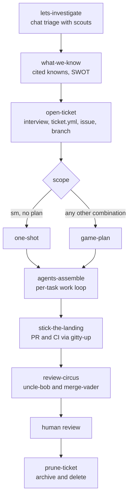

# mightymodels

A ticket-scoped development loop for Claude Code. One unit of work gets one `.mightymodels/<slug>/` directory and one `ticket.yml` carrying its scope and model routing. When the work merges, `/prune-ticket` compresses the directory into a 30-line archive and deletes it. The unit of deletion is the unit of work, which is what stops working state from turning into a landfill of stale evidence.

The plugin ships nineteen skills, twelve worker agents, seven hooks and one MCP server that holds the state.

## Why I built it

mightymodels is built from the failures of spec-driven development. It is oriented around human-in-the-loop decision making, and it is the plugin I cannot live without. It has cut my token consumption, the model gets more of the work right, and it has changed the way I work with AI.

Four parts of the design do most of that:

- The decisions stay with you. `lets-investigate` stops every round at a gate, `cross-examine` sends facts to scouts and decisions to you, `game-plan` gets your approval before the sprint starts, and only you can start `stick-the-landing` and `prune-ticket`.
- The plan is a ledger. `plan.md` holds invariants with proving commands, tasks with acceptance criteria and verify commands, non-goals, and risks with the handling you chose. It is free of code-level citations and written to survive a compaction.
- Each worker refuses the work of the tier above it, which is what keeps the fleet cheap. The intern takes the tasks a plan sizes `tiny`, the engineer is the default implementer, and the higher-cost architect takes only what the engineer failed or a reviewer rejected.
- A task is done when commands say so. It closes after its contract commands pass at the new HEAD and the fact-checker has checked what was done against what was asked. A `git push` is denied until every live contract command has a passing receipt.

## Requirements

- Claude Code.
- [uv](https://docs.astral.sh/uv/) on `PATH`. The launcher, the hooks and the state server all start through `uv tool run`.
- Python 3.14 or newer. uv fetches it, so nothing needs installing by hand.
- A POSIX system. Everything in `bin/` is an `sh` or `bash` script and there is no Windows launcher.
- `git`. A ticket's files live in `.mightymodels/` at the git toplevel of the repository you are working in, and the hooks look up the ticket for the checked-out branch.
- The [GitHub CLI](https://cli.github.com/) (`gh`), logged in, for issues, pull requests and CI watching. Without it `open-ticket` keeps the issue body as a file and shows you the command, and `stick-the-landing` shows the `gh pr create` command and stops.
- The `jira` CLI, only if you pick Jira as a ticket's tracker. Without it `open-ticket` writes a draft file.
- Network access to a package index the first time uv builds the environment.

## Install

```text
/plugin marketplace add <owner>/rygentic-harness
/plugin install mightymodels@rygentic-harness
```

Run `/agents` in a session afterwards. The twelve workers should be listed as `mightymodels:<folder>:<name>`. If they are not, fix the install before debugging the loop, because the ticket routing dispatches workers by those types.

Plugin skills show up as `/mightymodels:agents-assemble`, and the short form `/agents-assemble` works whenever the name is unambiguous in your session.

## The loop



Each stage has one job, writes one artifact, and reads `ticket.yml` before doing anything else. [docs/workflow.md](../../docs/workflow.md) walks through the stages one at a time.

Contracts shared by every stage live with the skills that own them. The severity table, the verdict vocabularies and the two-half brief schema are in `skills/agents-assemble/references/contracts.md`. The ticket schema and the directory layout are in `skills/open-ticket/references/`. When a skill and a contract disagree, the contract wins and the skill gets fixed.

## Skills

Claude Code picks a skill from your prompt and the skill's description, or you name it with a slash. Three run only when you start them: `stick-the-landing`, `prune-ticket` and `crashout`. Four are never invoked by hand, because a worker or the primary loads them: `agent-debugging`, `becoming-uncle-bob`, `becoming-merge-vader` and `prompting-subagents`. [docs/skills.md](../../docs/skills.md) has the long version of every row below.

### The loop stages

| Skill | What it does |
| --- | --- |
| `lets-investigate` | Opens a chat-first investigation before any ticket exists. Scouts get one narrow question each, and every round stops at a gate where you choose to dig further, redirect, stop or consolidate. |
| `what-we-know` | Consolidates understanding: knowns with file:line or URL citations, the uncertainties, and an analysis shaped by the question. |
| `open-ticket` | Turns an understood problem into a staged ticket: the directory, the issue or a local draft, the branch, and `ticket.yml` with derived model routing. |
| `one-shot` | The fast ramp. One dialog, a scout check of the claims at HEAD, a task list with an acceptance criterion per task, then straight into `agents-assemble`. It writes no plan or handoff file. |
| `cross-examine` | Interviews you about a plan, design or decision at a depth you pick first: Skim, Standard or Relentless. |
| `game-plan` | The large-scope ramp. Scouts verify the ticket's claims, `terry-toolchain` surveys the environment, `cross-examine` runs, and `plan.md` is written as a compaction-safe ledger. |
| `break-it-down` | Splits a task that is too large (more than four acceptance criteria or more than ten owned files) into reviewable pieces. It changes nothing before you answer. |
| `agents-assemble` | The per-task work loop: citations, the two-half brief, a dispatch, the contract commands at the new HEAD, the fact-checker, then verify. It ends in a `REPORT.md` of at most 50 lines and never pushes. |
| `stick-the-landing` | Closes the sprint: pushes, opens the PR from the repository's template and has `gitty-up` watch CI. |
| `review-circus` | The endgame review. `uncle-bob` and `merge-vader` run in parallel, and an abridged comment is always posted to the PR, pass or fail. Only the findings you pick get fixed. |
| `baton-pass` | Hands a session to the next one: `handoffs/BATON.md` with the facts that live nowhere else, and an opening prompt for the next session. |
| `prune-ticket` | Closes out finished work: a 30-line archive, documentation updates proposed as diffs, then deletion of the ticket directory on your confirmation. It refuses while live work remains. |

### Escalation and debugging

| Skill | What it does |
| --- | --- |
| `ask-an-adult` | Takes a judgment call that cannot be decided to `wingman`, and carries its questions to you before work resumes. For reasoning, not for facts a scout can retrieve. |
| `whats-broken` | The primary's debugging protocol: reproduce, gather evidence, test one falsifiable hypothesis at a time, then fix through a normal engineer dispatch with a regression test. Three strikes and it escalates. |
| `agent-debugging` | The same protocol for one engineer with nobody to dispatch. A fourth failed fix is refused and the engineer reports `blocked`. |

### Doctrines and the fleet reference

| Skill | What it does |
| --- | --- |
| `becoming-uncle-bob` | The `uncle-bob` worker's doctrine: grade a branch or a codebase against SOLID, the Clean Code smells catalog and the Clean Architecture component metrics. |
| `becoming-merge-vader` | The `merge-vader` worker's doctrine: an adversarial pre-merge review that ends in `BLOCK`, `MERGE WITH CONDITIONS` or `CLEAR`. |
| `prompting-subagents` | Builds, checks or repairs the dispatch packet for a worker: which worker, which template, which model alias. |

### Utility

| Skill | What it does |
| --- | --- |
| `crashout` | The pressure valve. On an explicit `/crashout` it journals your rant verbatim, checks whether the failure has happened before, and turns repeated tilt into standing corrective actions. |

## Workers

The twelve workers are subagent files under `agents/`, in three folders. Claude Code makes the folder part of the agent type, so a worker is dispatched as `mightymodels:<folder>:<name>`, for example `mightymodels:workers:engineer`. Neither the bare name nor `mightymodels:<name>` is its type.

| Folder | Worker | Job |
| --- | --- | --- |
| `triage` | `code-scout` | Repository retrieval: files and symbols, call sites, config values, dependency versions. |
| `triage` | `web-scout` | Documentation retrieval: one official page, changelog or release note, cited by URL and section. |
| `triage` | `wingman` | The decision advisor. It has no tools and works only from the packet it is given. |
| `triage` | `terry-toolchain` | The environment surveyor, dispatched once per `game-plan` run. |
| `workers` | `engineer` | The default implementer. One task group or one residual fix, inside the files the dispatch owns. |
| `workers` | `architect` | The higher-cost recovery implementer, for a task the engineer failed or a reviewer rejected. |
| `workers` | `intern` | The lowest-cost implementer, for a task the plan sizes `tiny`: one owned file. |
| `workers` | `gitty-up` | The CI watcher. It opens or takes a pull request and waits for the checks under a time budget, 20 minutes by default and 60 at most. |
| `review` | `uncle-bob` | The maintainability reviewer. |
| `review` | `merge-vader` | The release-readiness reviewer. |
| `review` | `qualitylens` | The measurement worker: code churn, change coupling and hotspots. |
| `review` | `fact-checker` | The task verifier. It checks a brief's DONE half against its ASKED half before the task closes. |

All of them are delegation-only. What keeps the fleet cheap is that each worker refuses the work of the tier above it.

The model pins are Claude Code aliases: `haiku`, `sonnet`, `opus` and `fable`. Every worker but the two reviewers runs on one fixed model, and a reviewer's model comes from the review run. [docs/agents.md](../../docs/agents.md) has the routing, who may dispatch whom and the report formats.

## Hooks

`hooks/hooks.json` registers seven hooks on five events. Each runs the plugin's CLI against the state database and has a timeout of 10 seconds.

- `SessionStart` exports the plugin data directory to the session's commands.
- `PreToolUse` on `Agent` is the dispatch hook. It holds a worker to the workers its agent file allows, and denies the main thread's dispatch of the engineer or the architect until a task is in progress.
- `PreToolUse` on `Edit`, `Write` and `Bash` is the main-thread hook. While the checked-out branch has one unclosed ticket, an edit outside the ticket directories is answered `ask`, and a `git push` is denied until no plan task is open and every live contract command has a passing receipt at HEAD.
- `SubagentStop` on the two scouts and `PostToolUse` on `SubagentHandback` leave a scout's report in the spool for search.
- `SubagentStop` on the engineer, the architect and the intern is the completion gate.
- `PreCompact` writes a snapshot of the ticket on the checked-out branch before a compaction.

With no unclosed ticket on the branch, the main-thread rules give no decision, as if the plugin were not installed.

> [!WARNING]
> The push rule reads the command's shell words. It holds `git -C <dir> push` and a push after `&&`, but a command that pushes without the words `git` and `push`, such as a git alias or a script, is not seen.

[docs/claude-code.md](../../docs/claude-code.md#hooks) has each rule in full, including what happens when the state cannot be read.

## State

The state lives in two places.

A ticket's files (`ticket.yml`, the plan, briefs, snapshots, review runs and archives) are in the target repository's `.mightymodels/` directory, at the git toplevel.

The rows (tickets, tasks, the verification contract and its receipts, review runs, ledgers, crashouts and closings) are in `mightymodels.db`, one SQLite database in the plugin data directory that Claude Code names in `CLAUDE_PLUGIN_DATA`. That file is outside every repository and serves all of them. The `scout-spool` directory beside it holds scout reports waiting to be stored.

`.mcp.json` declares one stdio server named `state`, started with `bin/mightymodels serve`. The skills call its tools as `mcp__plugin_mightymodels_state__<tool>`, and those tools and `AskUserQuestion` are the only ones a skill's `allowed-tools` pre-approves. No skill pre-approves `Bash`, `Edit` or `Write`.

[docs/state.md](../../docs/state.md) has the directory layout and `ticket.yml`.

## The launcher

`bin/mightymodels` is a shell script that runs the plugin's Python package through `uv tool run`:

```sh
PYTHONPATH="${root}/src" exec uv tool run --python '>=3.14' --compile-bytecode \
  --with-requirements "${root}/requirements.lock" \
  python -P -m mightymodels_plugin "$@"
```

The dependency versions come from `requirements.lock` in the plugin root. `bin/mightymodels-hook` wraps the launcher for the scout-report, completion-gate and `PreCompact` hooks. When the launcher cannot run, it prints `mightymodels hook did nothing` with the hook's name to standard error and exits 0. The dispatch hook and the main-thread hook have wrappers of their own, `bin/mightymodels-dispatch-hook` and `bin/mightymodels-main-thread-hook`, because they refuse some calls when the state cannot be read.

## Known limits

- Whether plugin agents surface, and under which names, depends on your Claude Code version behaving as the current docs describe.
- No trigger datasets ship in this repository, so nothing measures skill selection. A skill that runs when named but never selects itself has a description problem. A skill the slash menu cannot find has a loading problem.
- Under `claude -p` there is no permission prompt, so an `Edit` or `Write` the main-thread hook answers `ask` is refused, even with the tool in `--allowedTools`. No other permission mode was tested.
- Issue-tracker sprint and board operations are deliberately outside the plugin.

## Development

The plugin is the `mightymodels-plugin` package, a member of the repository's uv workspace. Run the repository's commands from the repository root:

```sh
make setup    # once: install the pre-commit hook and sync the workspace
make check    # the gate: sync the locked environment, run pre-commit, then scripts/quality.sh
uv run pytest plugins/mightymodels/tests   # this plugin's tests alone
```

[CONTRIBUTING.md](../../CONTRIBUTING.md) has the rest.

## Layout

```text
.claude-plugin/plugin.json  the plugin manifest
.mcp.json                   the state server
agents/                     the twelve workers, in triage/, workers/ and review/
bin/                        the launcher, the hook wrappers and gitty-up
hooks/hooks.json            the seven hooks
references/state/           the receipt schema and the runtime layout
skills/                     the nineteen skills
src/mightymodels_plugin/    the CLI and the state server
tests/                      the plugin's tests
pyproject.toml              the mightymodels-plugin package, a uv workspace member
requirements.lock           the pinned runtime dependencies
```
